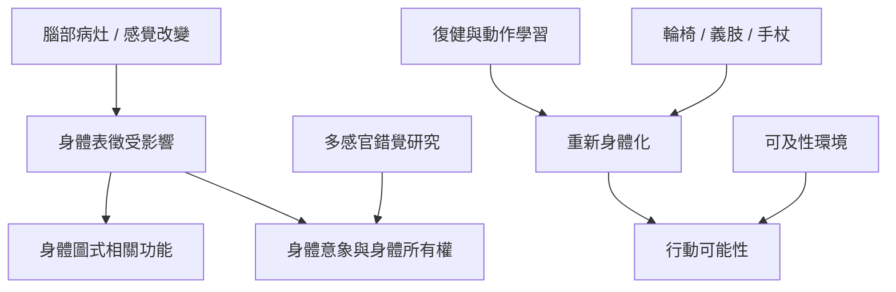

臨床神經心理學透過感覺缺損、身體忽略、幻肢與身體錯覺，觀察身體表徵的不同面向；復健與輔具研究則關注人如何重新學會行動。此圖把臨床現象、身體所有權、輔具學習與環境設計連在一起。

核心閱讀：[[身體圖式的歷史起點來自對腦損傷與感覺定位的臨床研究]]、[[橡膠手錯覺顯示身體所有權會受多感官同步影響]]、[[輪椅技能學習能使輔具逐漸融入行動能力]]、[[可及性設計應以多種身體的行動可能性為中心]]。

概念入口：[[身體所有權]]、[[行動主體感]]、[[神經可塑性]]、[[工具具身化]]。

回到導讀：[[Body_schema]]。
