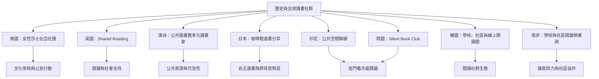

跨地區案例顯示，讀書會會隨社會條件形成不同樣貌：美國女性文學社團把閱讀與公共參與連結；英國共享閱讀連結文化和照護機構；澳洲圖書館以多元形式支援不同社群；日本咖啡館型書聊以個人選書開啟對話；印尼和跨國 Silent Book Club 以共處靜讀降低門檻；韓國與南非案例則顯示學校、圖書館和社區協作的重要性。

## 概念關係圖

[[女性讀書會曾把閱讀轉化為公共參與與社會改革]] [[英國The Reader以共享閱讀建立跨機構社群]] [[澳洲圖書館把讀書會擴展為多元閱讀社群]] [[日本東京咖啡讀書會以個人選書分享促進跨背景對話]] [[印尼Baca Bareng以公共空間中的安靜共讀降低參與門檻]] [[韓國閱讀社群從學校圖書館延伸至社區與線上空間]] [[南非教育部將學校閱讀俱樂部與社區閱讀俱樂部連結]]
