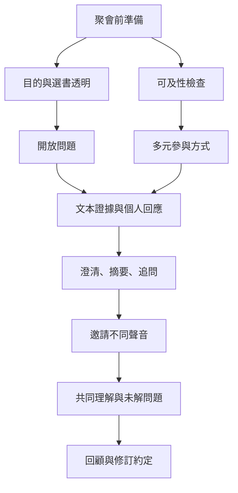

讀書會的對話品質取決於主持者如何安排參與，而不只取決於成員是否有話可說。好的引導要能讓文本證據與個人反應並存，讓不同意見可以被聽見，也能調整支配性發言、沉默與衝突。規則不是用來管制差異，而是保護所有人參與的可能性。

## 概念關係圖

[[好的引導者管理對話空間而不是展示知識]] [[閱讀聚會的安全感來自明確且共同維護的對話約定]] [[引導（Facilitation）是維持對話品質而非代替參與者得出結論]] [[細讀（Close reading）透過具體文本細節形成可檢驗的詮釋]] [[對話式學習（Dialogic learning）透過互相提問與回應共同建構理解]] [[可及性是讀書會設計的一部分而非事後補救]]
