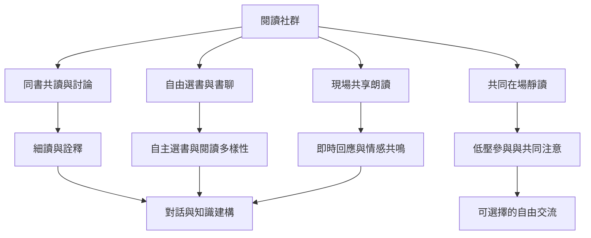

讀書會不是單一固定格式，而是由文本選擇、閱讀是否預先完成、是否朗讀、是否討論與參與者自主程度構成的一組方法。可以按活動目的組合形式：精讀與深入詮釋適合同書討論；降低門檻可用自由書聊；支持即時共同經驗可用共享閱讀；減少社交壓力可用安靜讀書會。

## 概念關係圖

[[讀書會（Book club）是一群人圍繞一本或一組書持續聚會]] [[閱讀小組（Reading group）可比讀書會涵蓋更廣泛形式]] [[共享閱讀（Shared reading）以現場朗讀和共同回應連結參與者]] [[安靜讀書會（Silent book club）以共同在場閱讀取代固定討論]] [[閱讀樂趣（Reading for pleasure）把自主選擇和內在享受置於核心]] [[不必每個讀書會都要求所有人讀同一本書]]
