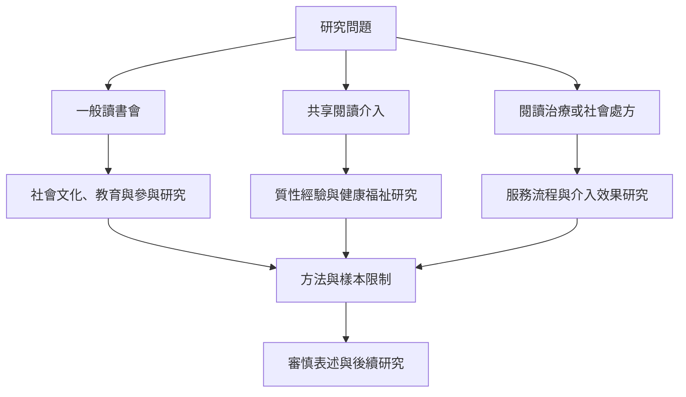

讀書會研究橫跨文學研究、社會學、教育、圖書館學與健康人文。一般讀書會的社會文化研究，不能直接等同共享閱讀的健康介入研究；組織影響報告也與控制組研究有不同證據層級。評估時應先界定活動模式與目標，再選擇適合的研究方法。

## 概念關係圖

[[2025年共享閱讀回顧指出福祉成果令人期待但證據仍有限]] [[高齡者共享閱讀研究指出社交與心理福祉可能受益]] [[讀書會的成效評估需同時呈現成果與研究限制]] [[閱讀治療（Bibliotherapy）以閱讀作為支持健康與自我理解的方法]] [[社會處方（Social prescribing）把非醫療社區資源納入健康支持轉介]]
