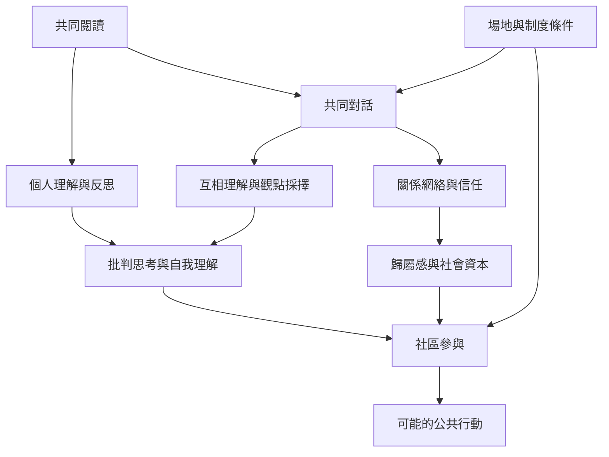

讀書會可能同時產生個人、關係與公共層次的作用：個人層次包括閱讀動機、理解與反思；關係層次包括認識他人、歸屬感和社會資本；公共層次則可能延伸至文化參與、公民學習和地方行動。這些是可能的作用路徑，不應把任何一項視為每個讀書會必然產生的結果。

## 概念關係圖

[[共讀群體能把私人閱讀轉化為公共對話]] [[讀書會可以成為公民學習與地方行動的組織形式]] [[社會資本（Social capital）是由關係網絡、信任與互惠構成的資源]] [[第三空間（Third place）是居家和工作之外可重複相遇的公共場所]] [[讀書會的社會效果來自文本與互動共同作用]]
