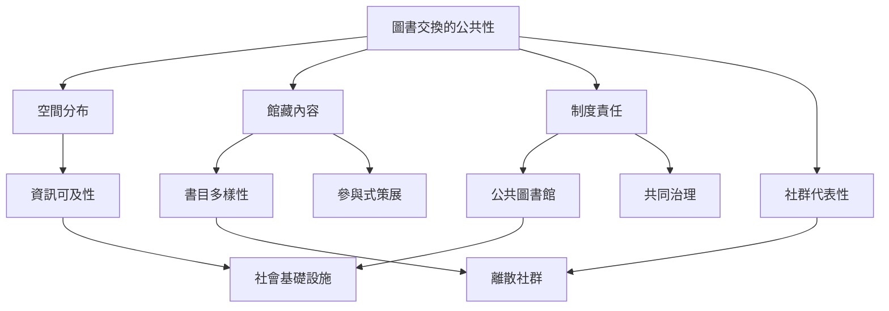

圖書交換的公共性不只由「免費」決定。書籍是否容易抵達、語言是否多元、場域是否安全、使用規則是否公平、館藏由誰決定，以及公共機構是否承擔長期責任，都會形塑實際可及性。民間書架能補充公共文化生活，但也可能集中在資源較豐富的社區，因此要把共享熱情與公平檢視放在一起。

本圖提醒：交換書架既是物品流通點，也是文化選擇與空間分配的制度。應同時問「有哪些書」「誰能拿到」「誰決定留下哪些書」「由誰長期維護」。

## 延伸閱讀
* [[社區交換書架不能取代公共圖書館的制度責任]]、[[交換活動的入口規則決定誰能參與與誰被排除]]。
* [[交換書架的藏書內容同時受管理者選書與社區地理影響]]、[[用公平指標檢查交換書架是否只服務高資源社區]]。
* [[去中心化藏書網絡能回應離散社群的語言需求]]、[[書籍流動的價值不應只用交換本數衡量]]。
* [[公共圖書館]]、[[書目多樣性]]、[[資訊可及性]]、[[離散社群]]、[[參與式策展]]。
