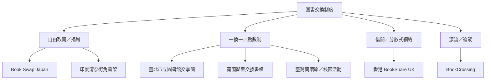

圖書交換不是單一制度，而是一組從自由取閱到正式管理的連續光譜。自由取閱降低參與門檻，但更仰賴共同維護；一換一或點數制提高規則清晰度，卻可能讓沒有可交換書籍的人難以加入；數位平台能擴大地理範圍，也帶來物流、隱私與志工持續性問題。

跨地區案例包含美國西雅圖的藏書調查、澳洲街角圖書館、日本校園交換書架、希臘交換圖書館、印度清奈的鄰里書架、英國香港移民 BookShare，以及台灣公共圖書館與閱讀節活動。這些案例的規模與研究方法不同，不能直接作績效排名。

## 延伸閱讀
* [[鄰里交換書架的互惠程度顯示低監管共享可以運作]]、[[西雅圖交換書架的藏書與公共圖書館形成互補]]。
* [[澳洲街角圖書館兼具禮物經濟與空間不平等]]、[[希臘交換圖書館在經濟危機中回應共享需求]]。
* [[香港移民以分散式共享圖書館維持繁體中文閱讀資源]]、[[台北市立圖書館以常設交享閱制度促進書籍再利用]]。
* [[日本Book Swap Japan以免費分享與自然場域創造相遇]]、[[BookCrossing用識別碼記錄書籍跨地域旅程]]。
