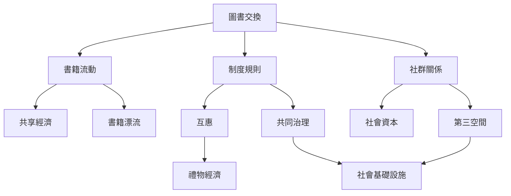

圖書交換的流動機制可從物品、規範與關係三個層次理解。書本從私人手中移動到新的讀者，可能透過贈與、交換、點數、借閱或平台追蹤；維持流通的則是信任、互惠規範與共同維護。物品流通不必然產生社群關係，但當人們共同照顧書架、分享推薦與討論，交換點可能成為日常相遇的節點。

這張圖的核心不是把所有形式合併，而是區分「書怎麼流動」「規則如何被維持」「人們如何形成關係」。可從[[交換制度可以很輕但需要可理解的互惠規範]]理解規則，從[[圖書交換同時生產物品流通與弱連結社會關係]]理解關係，並以[[書籍流動的價值不應只用交換本數衡量]]補足成效評估。

## 延伸閱讀
* [[圖書交換]]、[[互惠]]、[[禮物經濟]]、[[共享經濟]]、[[共同治理]]。
* [[第三空間]]、[[社會資本]]、[[社會基礎設施]]、[[書籍漂流]]。
