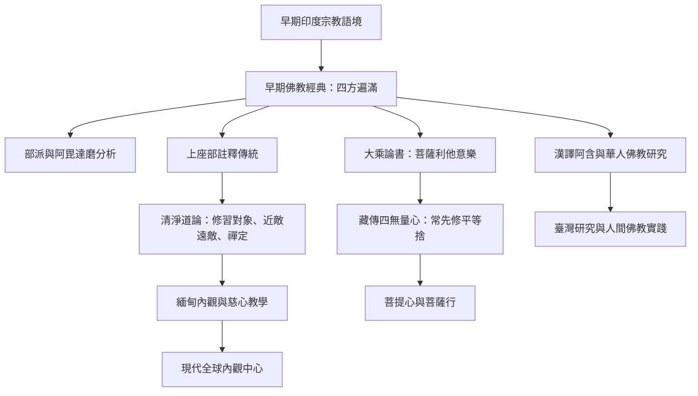

四梵住的歷史脈絡不是單線發展，而是不同文本與傳承對同一組心行不斷重新安排。早期經典以四方遍滿呈現心的無量性；上座部論書發展出具體修法與禪定分類；部派阿毘達磨進行心所與修道分析；大乘與藏傳論典則把四無量心放進菩薩利他願、平等捨與菩提心的脈絡。

各線索不可混成同一教法。研究時可對讀[[早期經典以四方周遍呈現四梵住的無量性]]、[[清淨道論把四梵住發展為細緻的禪修系統]]、[[西藏大乘傳統常先修平等捨再發展慈悲喜]]與[[大乘莊嚴經論把四無量心細化為菩薩的利他意樂]]，並用[[跨文化研究必須區分經文論書與現代心理詮釋]]維持來源層次。

本書導讀：[[Brahmavihara]]。
