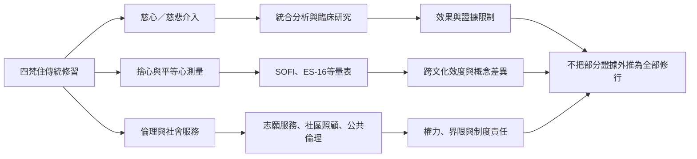

當代四梵住的跨域發展至少包括三條路徑：一是把慈心與慈悲轉成心理介入，研究正向情緒、同理與症狀；二是將捨等概念轉成心理量表，檢視文化與宗教語境如何影響操作化；三是把慈悲轉化為志願服務、社區照顧與公共倫理。各路徑彼此能啟發，但不可互相替代。

現代研究目前多集中慈心與慈悲，喜與捨的獨立研究仍不足。量表可協助比較，但無法完整測量智慧、倫理與解脫。公共照顧可借用四梵住作為倫理提問，但需要結合資源、權利與當事人參與。請參考[[慈心介入相較被動控制組具有小幅正向效果]]、[[長期慈心禪腦影像研究仍受小樣本限制]]、[[泰國研究嘗試在本土佛教語境中測量捨心]]及[[華人佛教慈悲實踐透過志願服務進入社會]]。

本書導讀：[[Brahmavihara]]。
