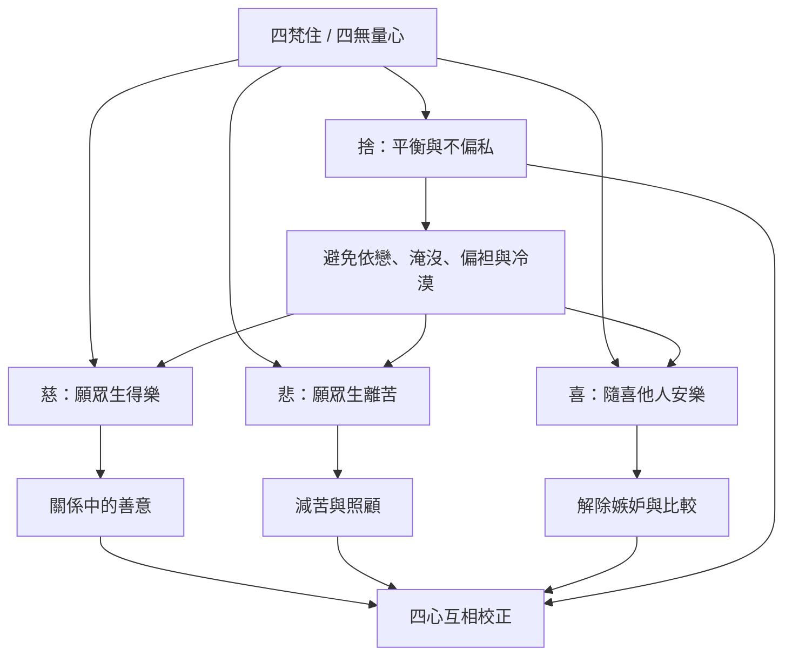

四梵住是以無量眾生為所緣的四種互補心行。慈、悲、喜分別回應安樂、痛苦與他人的幸福；捨則提供不偏私、不控制、能承認因緣的平衡。此圖以四種心態的關係為主，將近敵作為修習自我檢查工具。

慈不是佔有，悲不是共苦淹沒，喜不是自我比較，捨不是冷漠。四者共同形成可以延伸到日常互動與修行道路的倫理心態。可由[[慈]]、[[悲]]、[[喜]]、[[捨]]開始，再閱讀[[近敵]]與[[遠敵]]，最後參照[[四梵住是四種彼此校正的心態而非四種獨立情緒]]。

本書導讀：[[Brahmavihara]]。
