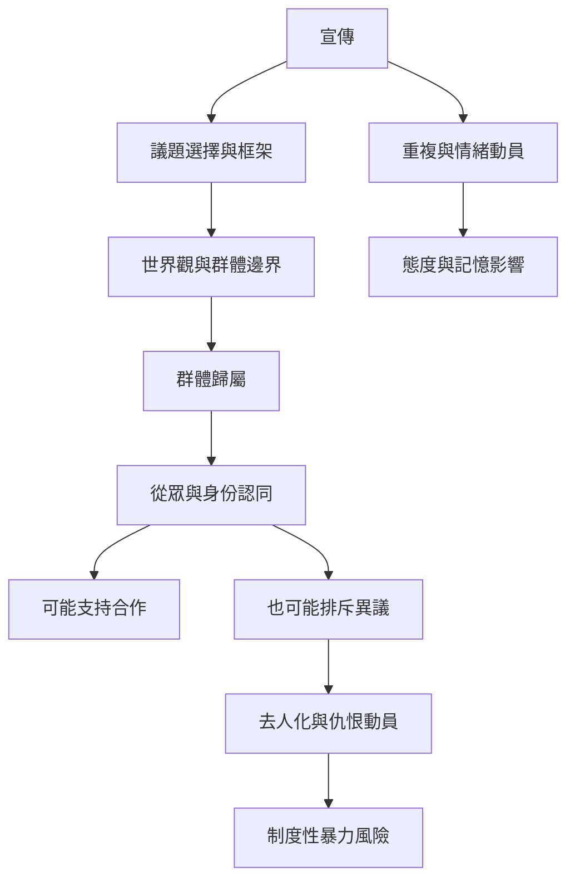

此圖聚焦宣傳如何透過訊息框架、群體身份與社會制度影響人。宣傳可以塑造議題與敵我界線，但若要討論強制思想改造，還需另行檢查強制、隔離、資源依賴與退出條件。

## 思與行

* 沿著圖中的箭頭追查概念之間的條件關係，並在閱讀新案例時修正連結。
* 不要把圖中的可能機制誤當成每個案例都必然發生的固定流程。

## 參考

* [[納粹政權透過學校青年組織與日常儀式灌輸種族民族主義]]、[[盧安達廣播宣傳透過去人化語言煽動對圖西族的集體暴力]]、[[宣傳可以塑造認知但不等於強制思想改造]]、[[集體歸屬能支持人也能成為思想封閉的工具]]。
* 概念入口：[[Brainwashing]]。
* 主題導讀：[[Brainwashing]]。
