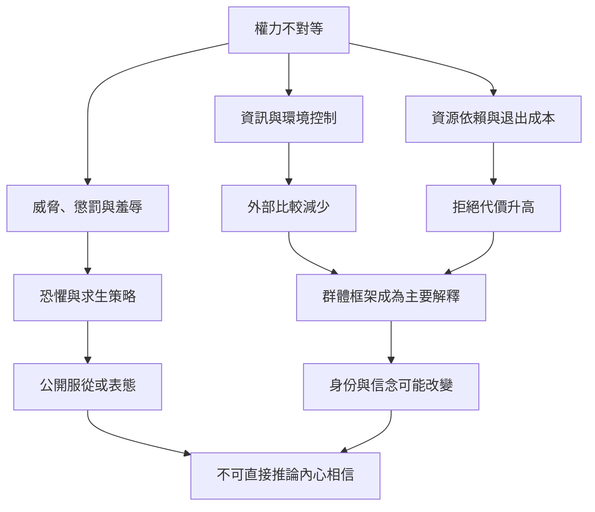

此圖用環境、關係、行為與心理結果呈現高控制環境可能如何運作。各項機制不是固定順序，也不是充分必要條件；需要個案證據來確認它們是否存在及如何互相強化。

## 思與行

* 沿著圖中的箭頭追查概念之間的條件關係，並在閱讀新案例時修正連結。
* 不要把圖中的可能機制誤當成每個案例都必然發生的固定流程。

## 參考

* [[Lifton以訪談個案分析中國思想改造而非單一腦控技術]]、[[Schein以社會心理模型分析戰俘在封閉環境中的強制說服]]、[[強制程度資訊封閉時間與退出成本比信念異常更能辨識操控]]、[[公開認罪不等於真誠相信]]。
* 概念入口：[[Brainwashing]]。
* 主題導讀：[[Brainwashing]]。
