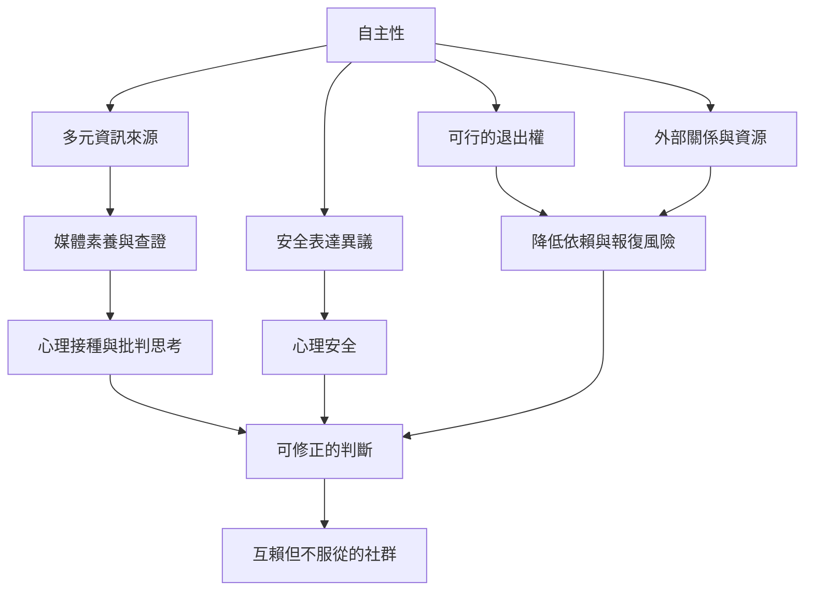

抵抗操弄不等於全面懷疑，也不應以另一套強制方式取代原有控制。這張圖將資訊能力、關係支持、異議空間與退出權放在同一套自主性設計裡。

## 思與行

* 沿著圖中的箭頭追查概念之間的條件關係，並在閱讀新案例時修正連結。
* 不要把圖中的可能機制誤當成每個案例都必然發生的固定流程。

## 參考

* [[預先揭露操弄技巧能提升辨識能力但不必使人全面懷疑]]、[[威脅自由的說服語言更容易引發心理抗拒]]、[[互賴不等於服從：健康社群讓成員保有多重連結]]、[[用非強制的關係修復取代反向洗腦]]。
* 概念入口：[[Brainwashing]]。
* 主題導讀：[[Brainwashing]]。
