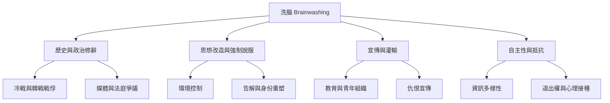

這張地圖把「洗腦」放在歷史修辭、強制環境、群體影響與自主性之間理解。中心不是一個神秘的心理按鈕，而是人如何在資訊、資源、關係與權力的條件下改變信念或行為。

## 思與行

* 沿著圖中的箭頭追查概念之間的條件關係，並在閱讀新案例時修正連結。
* 不要把圖中的可能機制誤當成每個案例都必然發生的固定流程。

## 參考

* [[冷戰時期的「洗腦」概念被新聞宣傳與政治心理戰共同塑造]]、[[洗腦不是心智遙控而是權力關係中的多層次影響結果]]、[[任何政治陣營都可能用洗腦標籤剝奪對方的能動性]]、[[抵抗操弄應培養可修正的判斷而非全面懷疑]]。
* 概念入口：[[Brainwashing]]。
* 主題導讀：[[Brainwashing]]。
