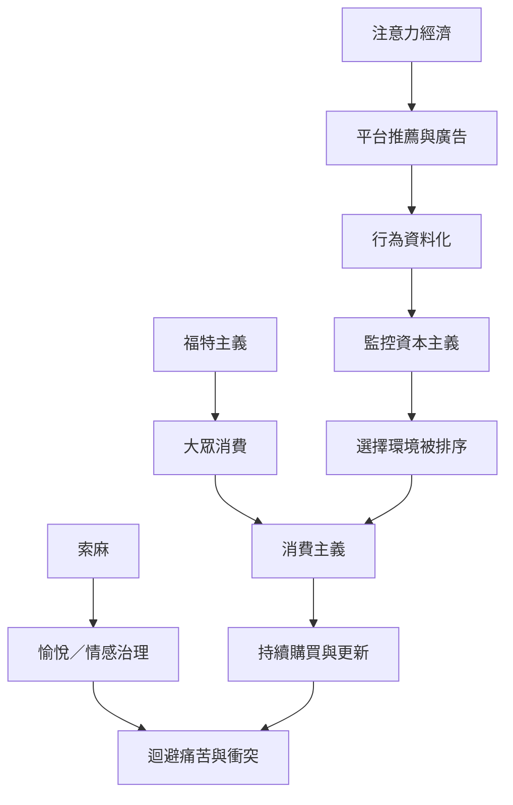

本地圖聚焦小說中的索麻、娛樂與消費文化，並將其與當代平台的注意力排序及資料化行為比較。相似處是欲望可能被環境塑造；差異處則須回到具體技術、商業模式與治理結構。

- 核心永久筆記：[[愉悅也能成為不必訴諸暴力的治理工具]]、[[索麻象徵把痛苦管理成私人消費問題]]、[[消費文化能把服從包裝成個人選擇]]、[[平台可以透過預測與排序塑造選擇環境]]。
- 核心概念：[[索麻]]、[[情感治理]]、[[消費主義]]、[[福特主義]]、[[注意力經濟]]、[[監控資本主義]]、[[演算法治理]]。
- 相關資料：[[福特主義把生產線邏輯延伸為世界國的社會秩序]]、[[《美麗新世界》的當代研究已延伸到平台權力與消費者身分]]。
- 相關靈感：[[用讀書會比較小說與今日平台介面來辨認欲望如何形成]]、[[把索麻的隱喻轉化為一份不羞辱人的情緒照顧地圖]]。
