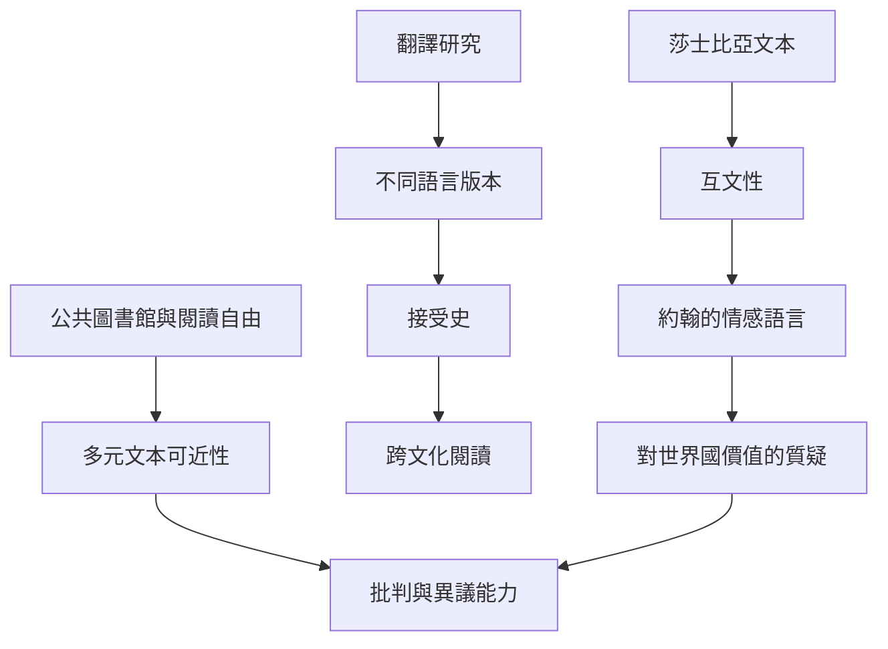

本地圖從約翰引用莎士比亞出發，連結文學語言、翻譯、跨文化接受與閱讀自由。文學不能保證反抗成功，但能使被壓縮的情感、歷史與價值重新獲得語言。

- 核心永久筆記：[[文學提供制度外部的情感與價值語言]]、[[跨文化閱讀需要同時檢查原文譯本與接受史]]、[[閱讀自由是民主社會維持異議能力的基礎]]。
- 核心概念：[[互文性]]、[[翻譯研究]]、[[接受史]]、[[媒體素養]]、[[思想自由]]。
- 相關資料：[[莎士比亞為約翰提供世界國無法理解的情感語言]]、[[日本與中國研究呈現小說在不同語言文化中的再閱讀]]、[[小說持續遭遇校園挑戰使閱讀自由成為作品的現實議題]]。
- 相關靈感：[[以莎士比亞朗讀夜練習說出難以被口號容納的情緒]]、[[比較不同中譯本看關鍵詞如何改變世界國的感受]]、[[設計一場自由閱讀與禁書史的公共討論]]。
