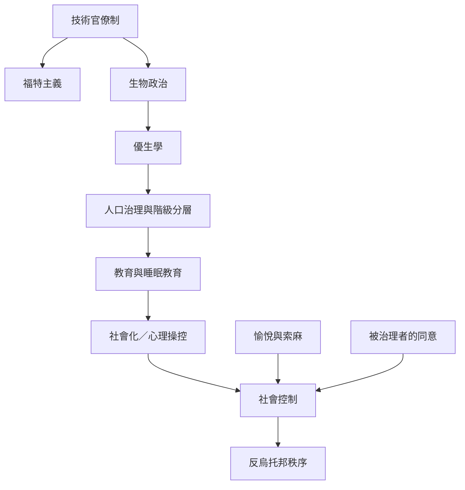

本地圖整理世界國如何把生命、生殖、階級、教育與心理制約整合為可持續的治理系統。閱讀時應同時注意制度的物質基礎與人們如何內化規範。

- 核心永久筆記：[[生物政治把生命特徵轉化為治理對象]]、[[以效率為名的分類容易把人化約為可配置資源]]、[[教育若只訓練適應就會削弱重新想像制度的能力]]、[[自由不只取決於制度權利也取決於形成判斷的能力]]。
- 核心概念：[[生物政治]]、[[優生學]]、[[技術官僚制]]、[[睡眠教育]]、[[心理操控]]、[[社會控制]]、[[反烏托邦]]。
- 相關資料：[[優生學運動使《美麗新世界》的人工生殖具有具體歷史背景]]、[[睡眠教育與識字制度使教育成為世界國的社會控制技術]]。
- 相關靈感：[[為每一項新技術設計權力與照顧影響檢核]]。
