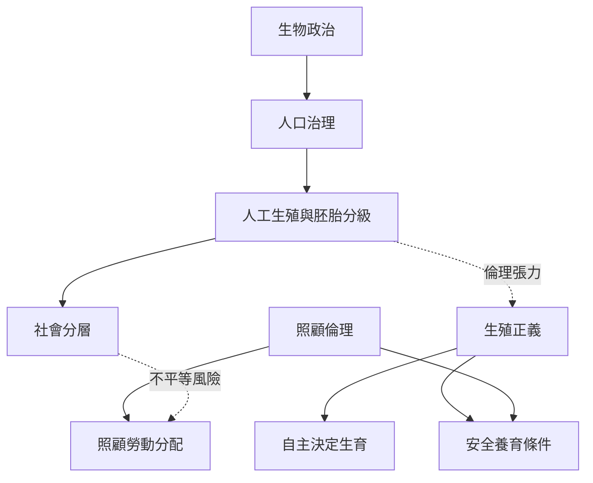

本地圖整理人工生殖、人口分類、母職與照顧責任之間的連結。小說批判的是生殖被國家壟斷與人被工具化，不應簡化成反對所有生殖科技或把某種家庭形式當成唯一自然選項。

- 核心永久筆記：[[家庭與生殖制度也是政治權力分配的一部分]]、[[技術本身不決定社會方向，決策權與收益分配才是關鍵]]。
- 核心概念：[[生物政治]]、[[優生學]]、[[生殖正義]]、[[照顧倫理]]、[[共同體]]。
- 相關資料：[[人工生殖與母職論述揭示反烏托邦中的性別政治]]、[[優生學運動使《美麗新世界》的人工生殖具有具體歷史背景]]。
- 相關靈感：[[為每一項新技術設計權力與照顧影響檢核]]。
