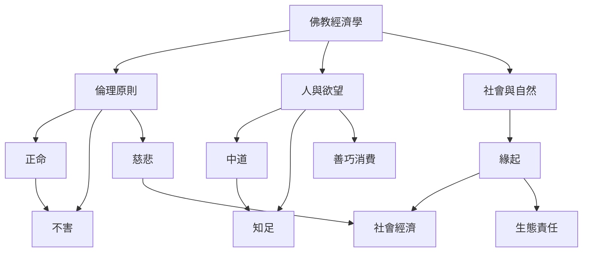

佛教經濟學的基礎可以從倫理原則、對人的理解與生態關係三個層次閱讀。[[正命]]把工作納入修行，[[中道]]與[[知足]]討論何謂適足，[[緣起]]則把個人選擇放回社會和自然的互依網絡。[[慈悲]]與[[不害]]讓減少痛苦成為經濟判斷的方向。此圖不是唯一教義架構，而是便於比較文本與實務的概念模型。

閱讀時可先讀 [[P. A. Payutto 以中道與善巧消費重述佛教經濟學]]、[[佛教經濟學以緣起與減苦挑戰利潤最大化假設]]，再回到 [[佛教經濟學不是一套跨時代且內部一致的經濟學派]] 與 [[緣起要求經濟決策看見人際與生態依存]]。
