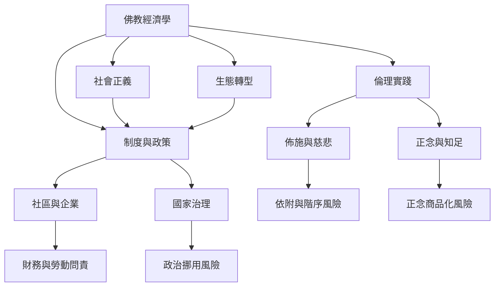

佛教經濟學的研究需要保留內在張力：慈善與權力、個人節制與制度改革、正念修習與商品化、寺院永續與使命偏移、社區互助與無酬勞動。[[新乘佛教]]提醒社會正義的維度；對[[去成長]]的討論則把物質吞吐與生態限度帶入政策；佛教組織也必須接受財務與治理檢驗。

參考 [[佛教經濟生活一直存在於跨國交換與宗教市場之中]]、[[泰國阿育社群以共同生活挑戰正念商品化與消費主義]]、[[韓國寺院經濟正從捐獻依賴走向多元收入與社會企業]]、[[越南佛教企業領導者以社群福祉與業果觀處理賄賂問題]]，並延伸 [[正念一旦脫離倫理脈絡可能成為市場的自我管理工具]]、[[社會正義不能被簡化成弱勢者個人的節制與自助]]、[[生態永續需要改變制度性生產消費而不只是個人選擇]]。
