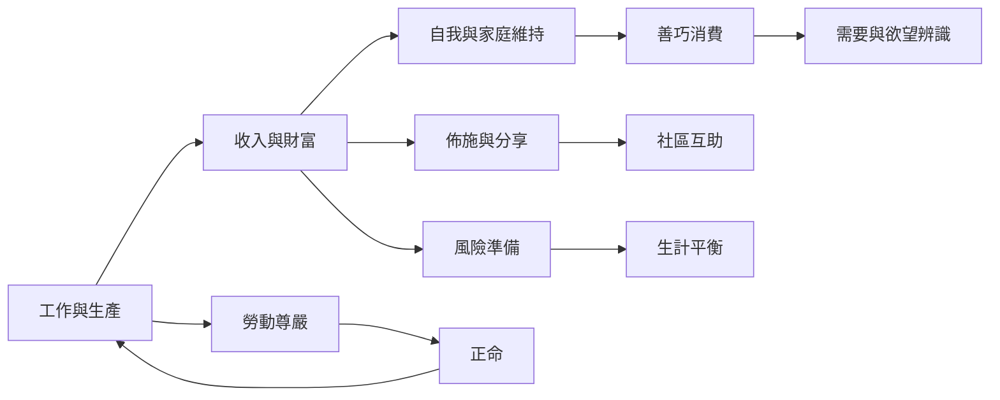

經濟生活可沿著工作、收入、消費、儲蓄與分享的流向來理解。[[正命]]關注收入如何取得，[[生計平衡]]處理在家人的生活安全，[[善巧消費]]檢查支出是否服務真實需要，[[佈施]]則讓資源流向家人、社群與修行支持。[[適切科技]]和工作制度共同決定生產如何影響人的能力與時間。

此圖適合搭配 [[《增支部》五集四十一經把財富視為照顧與布施的資源]]、[[《增支部》八集五十四經兼顧在家人的現世經濟與精神福祉]]、[[財富的倫理評價必須同時檢查取得方式與使用方向]] 與 [[善巧消費以生活功能檢驗欲望而非把消費當目的]]。
