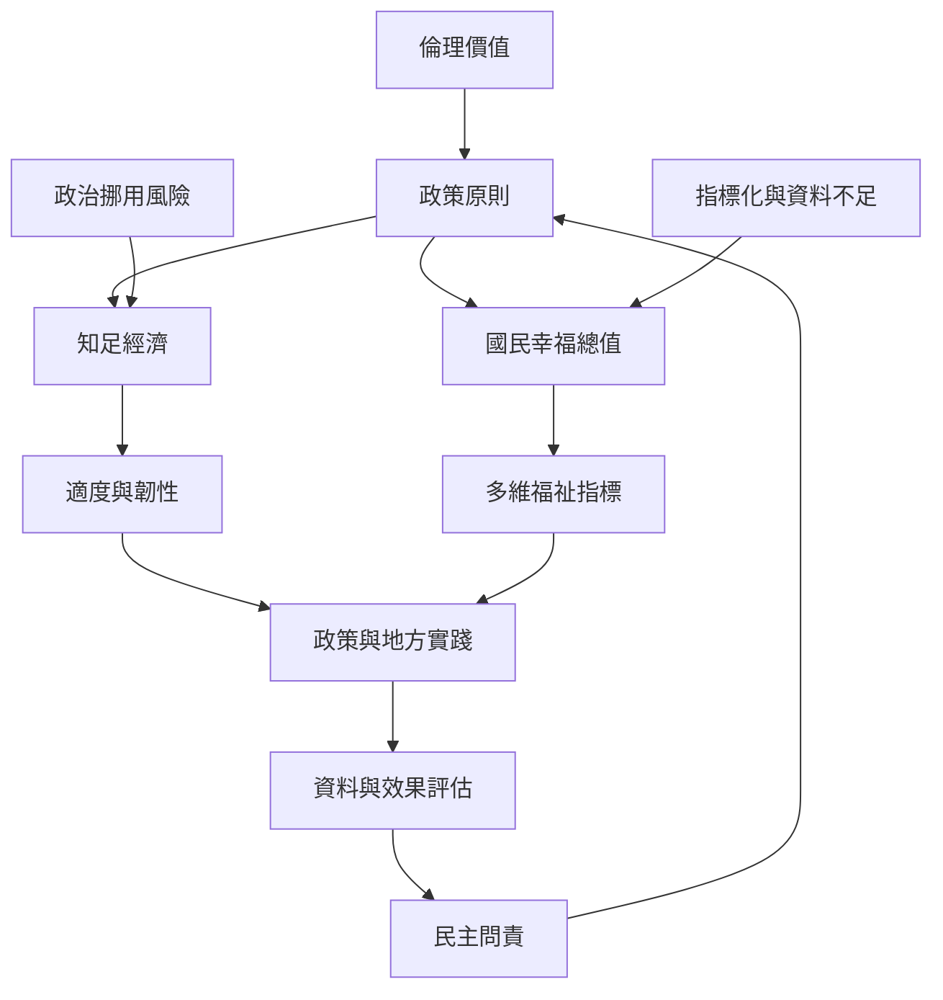

政策層次的佛教經濟學，需要比較[[知足經濟]]與[[國民幸福總值]]如何把倫理原則轉成制度工具。泰國案例凸顯知足論述與政治權力之間的張力；不丹案例則呈現多維福祉指標與政策審查的可能性。兩者都必須檢查誰定義適足與幸福、資料是否可靠、弱勢群體是否被看見，以及政策是否保障收入與公共服務。

搭配 [[泰國知足經濟同時具有倫理理想與政治用途]]、[[泰國知足經濟被連結到治理與永續發展實務]]、[[不丹國民幸福總值把福祉拆成多個政策領域]]、[[不丹幸福指標與國民所得的關聯仍需更密集的資料檢驗]] 閱讀，並參照 [[知足經濟必須與政治權力及分配正義一併檢視]] 與 [[衡量經濟要同時觀察物質安全時間照顧與社群關係]]。
