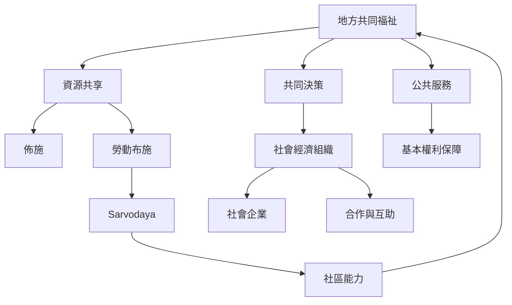

社區層次的佛教經濟實踐，常透過[[佈施]]、[[勞動布施]]、[[Sarvodaya]]、[[社會經濟]]與[[社會企業]]展開。資源分享可以補足市場交換，但必須避免將志工勞動浪漫化或讓捐助者控制受助者。社區自助的核心不是政府退出，而是讓居民成為共同決策者，並與公共服務、公平勞動和制度保障互補。

延伸閱讀 [[斯里蘭卡 Sarvodaya 以勞動布施推動村落自助]]、[[韓國寺院經濟正從捐獻依賴走向多元收入與社會企業]]、[[佈施在佛教傳統中兼具倫理修習與物質資源流動]]，並參照 [[社區自助使發展由受援者轉為共同作者]]、[[佈施能形成資源循環但也可能再製權力不平等]] 與 [[社會正義不能被簡化成弱勢者個人的節制與自助]]。
