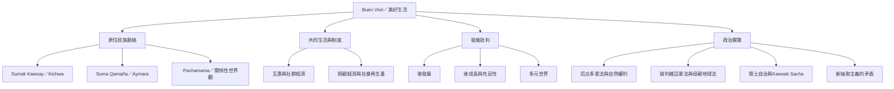

Buen Vivir 的核心不是一個可複製的政策包，而是多種原住民族生活哲學、社會運動與制度實驗之間的對話場域。閱讀時先從 Kichwa 的 sumak kawsay 與 Aymara 的 suma qamaña 進入，再理解國家憲法與政策如何翻譯這些概念，最後檢視去殖民、後發展與後成長的批判。

## 延伸閱讀
* 概念基礎：[[Buen_Vivir是安地斯與亞馬遜脈絡中多種美好生活論述的統稱]]、[[Sumak_Kawsay是Kichwa脈絡中的完整生活概念]]、[[Suma_Qamaña是Aymara脈絡中的共同和諧生活]]。
* 發展批判：[[Buen_Vivir不是把GDP換成幸福指數而是改變發展問題本身]]、[[多元世界承認不同社群具有不同生活與政治道路]]。
* 制度案例：[[厄瓜多憲法將自然存在與再生週期納入可主張的權利]]、[[玻利維亞憲法把Suma_Qamaña列為多民族國家的倫理原則]]、[[玻利維亞母親地球法把Vivir_Bien連結到生命系統再生與公共規劃]]。
