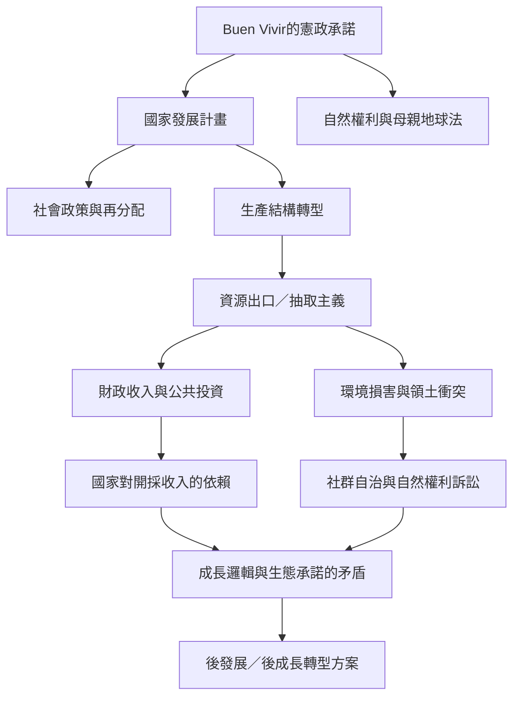

Buen Vivir 寫入憲法與發展計畫後，得到新的制度資源，但國家仍可能依賴石油、礦產與出口收入。此概念地圖將理念、政策、財政與地方領土衝突放在一起，避免只憑政策名稱判斷制度是否轉型。

## 延伸閱讀
* 制度分析：[[Buen_Vivir的制度化可能延續它原本要超越的成長邏輯]]、[[厄瓜多國家美好生活計畫同時追求社會權利與生產結構轉型]]。
* 抽取矛盾：[[新抽取主義把資源出口作為發展引擎]]、[[油業擴張暴露Buen_Vivir與新抽取主義的深層矛盾]]。
* 轉型方向：[[自然再生能力應成為經濟活動的硬性邊界]]、[[後成長主張以福祉充足與公平重新定位經濟]]。
