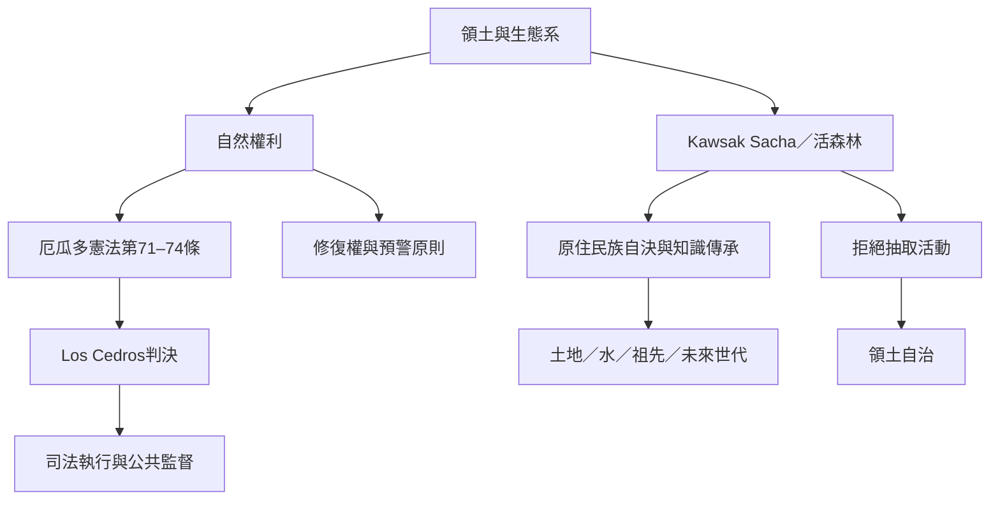

自然權利與 Kawsak Sacha 可在法律與社群政治兩個層次形成對話：前者提供自然作為權利主體的法理框架，後者則由 Sarayaku 社群提出其活森林與領土關係的自我表述。兩者有交集，但不可把原住民族世界觀完全化約成國家法律語言。

## 延伸閱讀
* 法律脈絡：[[自然權利讓生態系成為可主張權利的主體]]、[[預警原則在重大不確定風險下要求預防不可逆損害]]、[[厄瓜多憲法將自然存在與再生週期納入可主張的權利]]、[[Los_Cedros判決確認厄瓜多自然權利具有可執行法律效力]]。
* 社群脈絡：[[Kawsak_Sacha是Sarayaku提出的活森林領土觀]]、[[土地與森林是維持關係與知識的生命領域]]。
