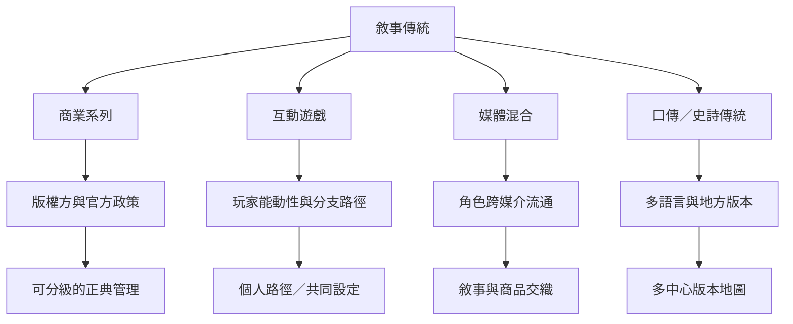

正典不是可以直接套用在所有敘事傳統上的普遍制度。商業系列可能由版權方管理；互動遊戲需要處理玩家的不同路徑；日本媒體混合重視角色跨媒介流通；南亞口傳史詩則可能由多個地方傳統共同延續。研究前應先辨認作品的產製與傳承方式。

## 延伸
* [[term/Canon (fiction)]]、[[term/Player agency]]、[[term/Media mix]]、[[term/Fictional universe]]。
* [[note/不同版本的神話敘事不應被錯誤收編成單一官方正典]]、[[note/玩家能動性使遊戲正典成為多條可能路徑的集合]]、[[note/文學經典與虛構正典處理的是兩種不同的收錄問題]]。
* [[idea/把地方史詩整理成多中心版本地圖而非單一正典樹]]、[[idea/以多路徑資料結構呈現遊戲的個人正史與共同世界]]。
* 本書導讀：[[Canon_(fiction)]]。
