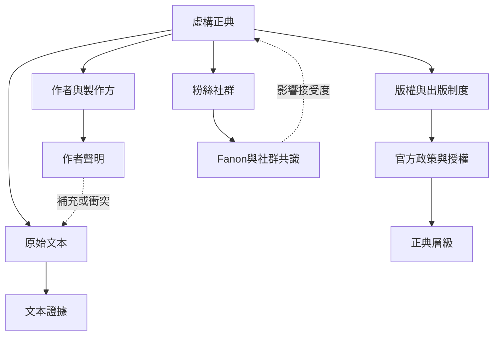

虛構正典是一種對故事世界事實的承認制度。它可能依據原始文本、作者聲明、版權方政策與粉絲共識，但各種權威並不相等，也不會永遠一致。把來源和權力關係分開，才能理解正典爭議為何常常不只是「設定對不對」。

## 延伸
* [[term/Canon (fiction)]]、[[term/Fanon]]、[[term/Fan fiction]]、[[term/Literary canon]]。
* [[note/正典不是作品全部而是被承認為有效的虛構事實]]、[[note/正典權威來自多種來源，不能簡化為作者一句話]]、[[note/正典層級比官方與非官方的二分更能處理多媒介系列]]、[[note/正典治理同時涉及知識、權力與商業利益]]。
* [[idea/為故事知識庫建立來源分級與正典狀態欄位]]、[[idea/讓粉絲參與正典協商但公開決策權與異議處理方式]]。
* 本書導讀：[[Canon_(fiction)]]。
