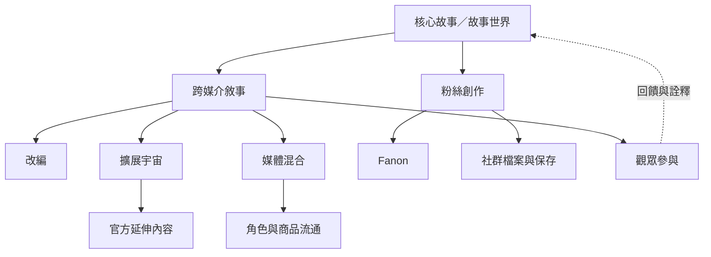

當故事跨媒介流通時，改編、故事延伸、商品化與觀眾參與常同時發生。不同媒介不一定擁有相同正典地位；粉絲也可能產生大量非官方創作，並使 fanon 成為社群共享的故事資源。

## 延伸
* [[term/Transmedia storytelling]]、[[term/Adaptation]]、[[term/Expanded universe]]、[[term/Media mix]]、[[term/Participatory culture]]、[[term/Fan fiction]]、[[term/Fanon]]、[[term/Diegesis]]。
* [[note/跨媒介擴張使正典邊界成為媒介設計問題]]、[[note/粉絲共同體可以形成 fanon，但共識不會自動成為官方正典]]、[[note/粉絲作品的保存必須同時考慮作者同意與社群安全]]。
* [[idea/保存粉絲作品時把作品脈絡與作者控制權一起保存]]。
* 本書導讀：[[Canon_(fiction)]]。
