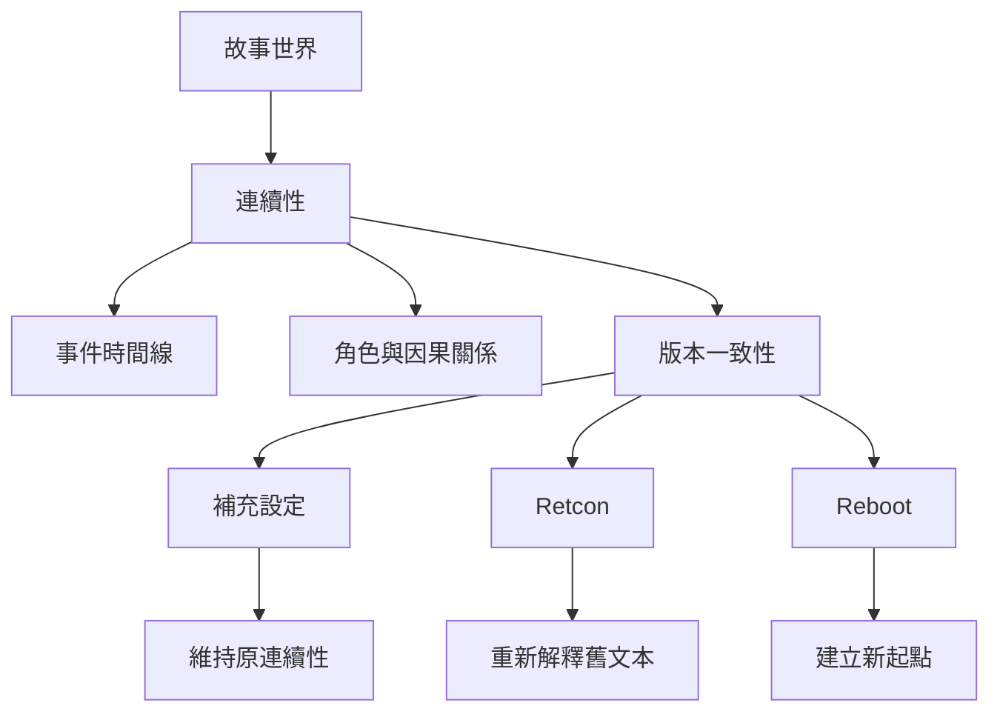

連續性讓多部作品可以被理解為同一條故事歷史。當新舊文本衝突，創作者可選擇補充、追溯修訂或重啟；這些行動改變的不只是某個設定，也可能改變讀者如何理解舊作品與角色關係。

## 延伸
* [[term/Continuity]]、[[term/Retcon]]、[[term/Reboot]]、[[term/Fictional universe]]。
* [[note/連續性是正典跨文本維持時間與因果關係的結構]]、[[note/追溯修訂會改變舊文本在整體故事世界中的意義]]、[[note/正典治理必須保留版本歷史，而不是只保留最新答案]]。
* [[idea/用事件溯源方式記錄故事設定的追溯修改]]、[[idea/用版本公告降低正典重設對粉絲記憶造成的斷裂]]。
* 本書導讀：[[Canon_(fiction)]]。
