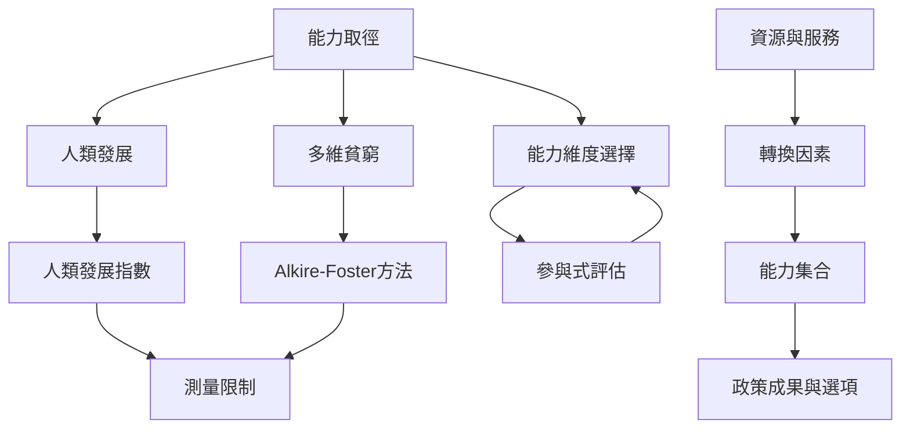

本圖呈現能力取徑如何進入政策評估：從資源與服務投入，檢查個人、社會、環境轉換因素，再觀察能力集合及功能實現；多維貧窮指數與 HDI 可提供部分統計資訊，但需搭配質性資料與參與式審議。

## 關係圖

## 連結筆記
* 概念：[[人類發展]]、[[人類發展指數]]、[[多維貧窮]]、[[能力剝奪]]、[[參與式評估]]、[[轉換因素]]。
* 永久筆記：[[貧窮是多重能力剝奪而非單一收入不足]]、[[多維貧窮指數能顯示剝奪的重疊但不能取代能力分析]]、[[人類發展指數只能摘要部分能力成果]]。
* 文獻：[[聯合國人類發展報告把人的選擇放在國家進步的中心]]、[[Alkire與Foster以雙重門檻建立多維貧窮衡量方法]]、[[2026全球多維貧窮指數持續以分解資料呈現剝奪差異]]。
* 行動：[[為一項公共服務進行能力審計看它擴大誰的選項]]、[[建立地方版能力地圖並公開指標選擇的理由]]。

* 補充卡片：[[不平等]]、[[指標可以監測剝奪但不能代替公共判斷]]、[[人類發展是擴大人們有理由珍視的選擇]]、[[無障礙環境是實質自由的公共條件]]。
回到導讀：[[Capability_approach]]
