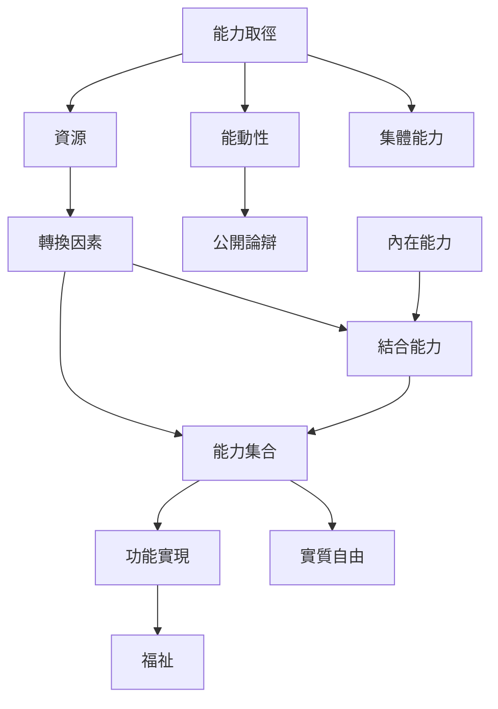

本圖整理能力取徑的基本評估單位：資源如何經由轉換因素形成能力集合，部分能力被選擇後表現為功能實現；整個過程同時涉及福祉與能動性。讀圖時不要把能力誤讀成個人技能，也不要將功能實現與自由混為一談。

## 關係圖

## 連結筆記
* 核心概念：[[能力取徑]]、[[能力]]、[[功能實現]]、[[能力集合]]、[[轉換因素]]、[[資源]]、[[實質自由]]、[[能動性]]、[[內在能力]]、[[結合能力]]。
* 分析命題：[[能力取徑評估的是可選擇的生活而非既成狀態]]、[[資源公平不等於轉化資源的自由公平]]、[[內在能力必須與外在制度條件結合才成為可行選項]]。
* 證據：[[能力取徑把福祉評估從資源與效用轉向實質自由]]、[[森以公開論辯與民主選擇避免預設單一好生活清單]]。
* 靈感：[[把資源盤點改成轉換條件盤點找出自由受限的地方]]。

* 補充卡片：[[不平等]]、[[人權]]、[[人類發展是擴大人們有理由珍視的選擇]]、[[教育的價值在於擴大生活選項與判斷能力]]。
回到導讀：[[Capability_approach]]
