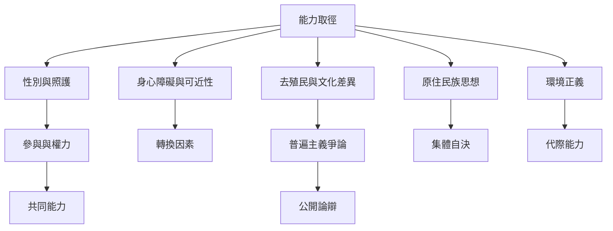

能力取徑的爭論不只關於定義，也涉及誰有權決定好生活、如何處理文化差異，以及個人主體與集體關係的張力。性別、身心障礙、去殖民教育、原住民族思想與生態正義，讓理論必須面對權力、互賴與環境限制。

## 關係圖

## 連結筆記
* 概念：[[轉換因素]]、[[集體能力]]、[[適應性偏好]]、[[社會資本]]。
* 永久筆記：[[能力取徑的普遍門檻與地方自主需要同時被保護]]、[[能力取徑必須把互賴與照護納入正義分析]]、[[永續發展必須保留當代與未來世代的生活能力]]。
* 文獻：[[性別不平等研究需要說明能力清單如何被選出]]、[[身心障礙研究提醒能力取徑必須看見社會與環境轉換因素]]、[[去殖民課程研究揭示普遍價值與知識權力之間的張力]]、[[原住民族與非西方哲學拓展能力取徑對關係自然與集體自決的理解]]。
* 行動：[[用步行安全與可近性檢查城市的實質自由]]、[[把生態限制納入生活能力而非消費選擇的擴張]]。

* 補充卡片：[[身心障礙]]、[[照護]]、[[永續發展]]、[[環境正義]]、[[能力取徑需要容納多元知識而非只更換文化內容]]、[[人的繁盛仰賴與土地及其他物種的關係]]。
回到導讀：[[Capability_approach]]
