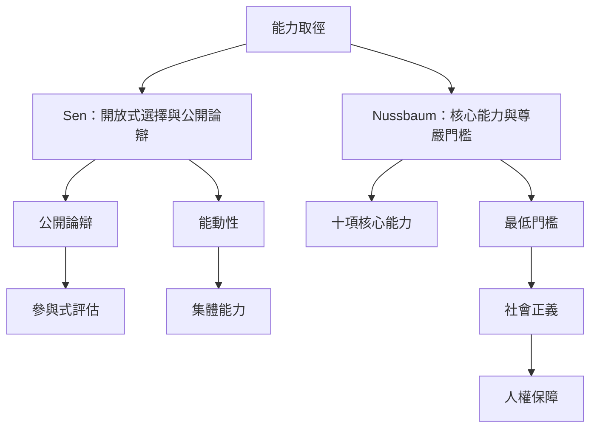

本圖對照 Sen 的公開審議取向與 Nussbaum 的核心能力門檻。兩者都將人的實質自由置於中心，但對能力清單、普遍主張與制度保障的具體化方式有所不同。此地圖用來理解能力取徑如何從福祉評估走向社會正義與基本權利。

## 關係圖

## 連結筆記
* 理論：[[能力取徑]]、[[核心能力]]、[[公開論辯]]、[[參與式評估]]、[[社會正義]]、[[人權]]。
* 永久筆記：[[核心能力的門檻保障自由而非規定每個人如何生活]]、[[能力維度的選擇必須讓受影響者參與公開審議]]、[[能力取徑的普遍門檻與地方自主需要同時被保護]]。
* 文獻：[[努斯鮑姆以十項核心能力提出尊嚴生活的最低門檻]]、[[能力維度的選擇應結合明確標準與參與式審議]]、[[能力取徑的理論普遍性必須接受文化與民主程序的檢驗]]。
* 延伸：[[與社群共同決定生活品質的核心維度]]、[[建立地方版能力地圖並公開指標選擇的理由]]。

* 補充卡片：[[社會正義]]、[[人權]]、[[能力取徑需要容納多元知識而非只更換文化內容]]、[[核心能力的門檻保障自由而非規定每個人如何生活]]。
回到導讀：[[Capability_approach]]
