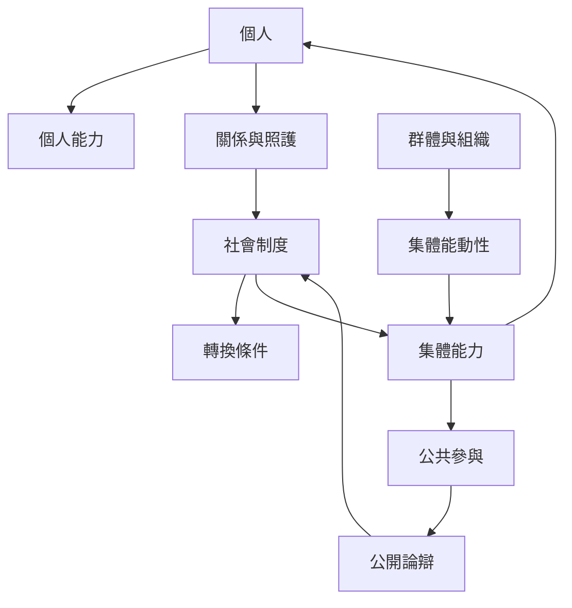

個人自由並非孤立個體的成就。家庭、社群、公共制度與互助組織會創造支持，也可能產生壓迫。此圖將個人能力、集體能力、照護關係與社會制度放在同一張圖中，強調共同能力需有公平參與與內部問責。

## 關係圖

## 連結筆記
* 概念：[[集體能力]]、[[能動性]]、[[能動性自由]]、[[社會資本]]、[[公開論辯]]。
* 永久筆記：[[共同能力不是個人能力的簡單加總]]、[[能力取徑必須把互賴與照護納入正義分析]]、[[福祉與能動性必須分開評估才能看見人的公共行動]]。
* 文獻：[[埃及自助團體研究顯示集體行動能擴展共同能力]]、[[社會制度與群體關係是個人繁盛的必要條件]]、[[南印度女性自助團體把金融活動轉化為公民參與與集體發聲]]。
* 行動：[[把續食餐桌設計成擴展共同能力的地方基礎設施]]、[[設計互助組織時同時保護個人自由與共同決策]]、[[為互賴生活建立個人與群體能力地圖]]。

* 補充卡片：[[照護]]、[[集體組織能把生活困境轉成公共議題]]、[[自主不是不依賴他人而是能參與決定自己的生活]]、[[照護制度應擴大被照顧者的選擇而非只追求功能正常化]]。
回到導讀：[[Capability_approach]]
