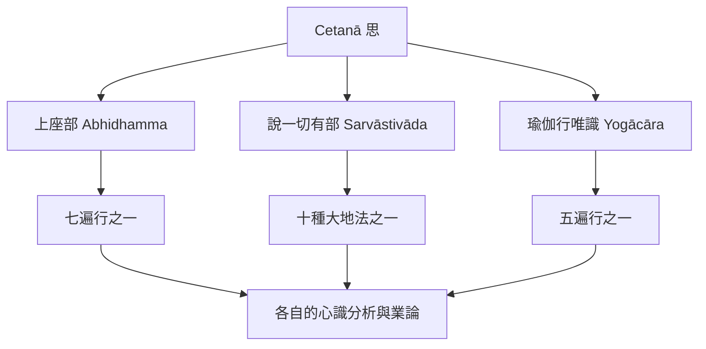

不同阿毘達磨傳統都重視思的普遍性，但其心所分類系統並不相同。上座部以七遍行心所分析所有心識活動；說一切有部以十種大地法建立另一套分類；瑜伽行唯識列出五遍行心所。不要將數目差異解讀為術語完全相同或理論彼此可直接互換。

延伸閱讀[[思在不同阿毘達磨傳統中具有普遍性但分類數目不同]]、[[上座部阿毘達磨將思列為七個遍一切心的心所之一]]、[[說一切有部以思解釋心如何推動善不善與無記業]]。

相關概念：[[思（Cetanā）]]、[[心所（Cetasika）]]、[[心（Citta）]]。
