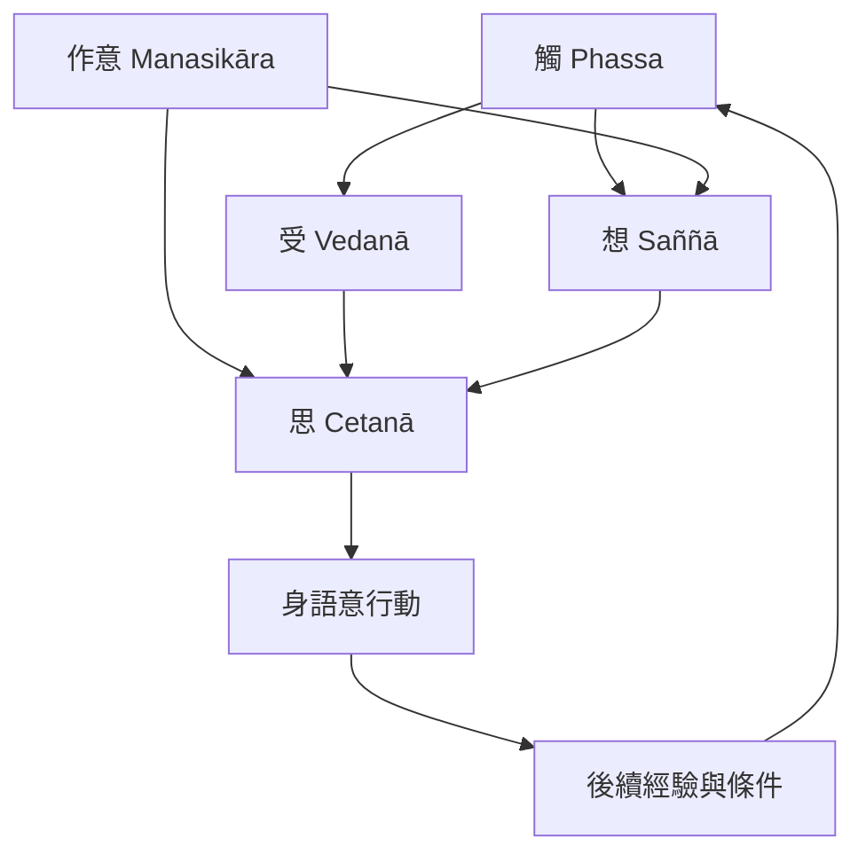

此圖聚焦佛教心所分析中的功能關係。觸、受、想、作意與思不是彼此獨立的心理零件，而是用不同角度描述心識活動的功能。圖中以相互影響表示概念關聯，不將它誤讀為跨所有佛教傳統都一致的時間流水線。

此圖應與[[思心所是心識中的造作與推動作用而非一個常住的自我]]、[[觸與受提供思形成的情境條件]]、[[思是上座部七遍行心所之一因此不只出現在刻意決策時]]一起閱讀。

相關概念：[[觸（Phassa）]]、[[受（Vedanā）]]、[[想（Saññā）]]、[[作意（Manasikāra）]]、[[思（Cetanā）]]、[[心（Citta）]]。
