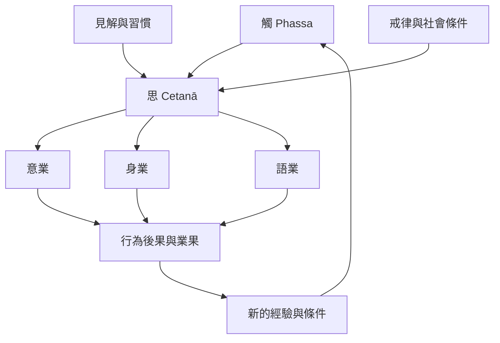

此圖整理早期佛教經典與阿毘達磨論述中，思如何與觸、身語意行為及業果相連。AN 6.63 明確把思稱為業，並指出觸是業的因；業果與止息則置於修道脈絡中理解。圖示是概念摘要，不代表業果只有單一線性決定因素。

閱讀重點：思是重要條件，不等於一個不受因緣制約的主宰者；也不應把一切遭遇都歸因於個人過去業。延伸閱讀[[思心所是業的關鍵條件但不是脫離因緣的自由意志]]、[[道德判斷需要同時考慮動機與因緣條件]]、[[思是意業而身語業由思所起]]。

相關概念：[[思（Cetanā）]]、[[業（Kamma）]]、[[依緣而起（Paṭiccasamuppāda）]]、[[行蘊（Saṅkhāra-khandha）]]。
