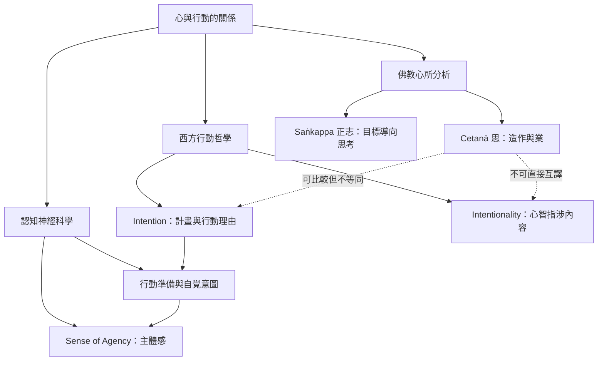

這張地圖把佛教思心所、哲學意圖與意向性，以及神經科學的行動準備與主體感放在同一個比較框架中。它們不是同義詞，而是處理心理活動、行動解釋與主體經驗的不同層次。

核心提醒：佛教思主要放在心識與業的因果分析；西方 intention 會分析計畫、理由與有意行動；intentionality 討論心智內容；神經科學則測量行動準備、時間知覺與主體感。延伸閱讀[[佛教的思不能被縮減為西方意圖論]]、[[意向性研究心智內容而思心所研究意志造作]]、[[行動準備與自覺意圖的時間差仍有多種解釋]]。

相關概念：[[思（Cetanā）]]、[[正志（Saṅkappa）]]、[[意圖（Intention）]]、[[意向性（Intentionality）]]、[[意志（Volition）]]、[[行動感（Sense of Agency）]]。
