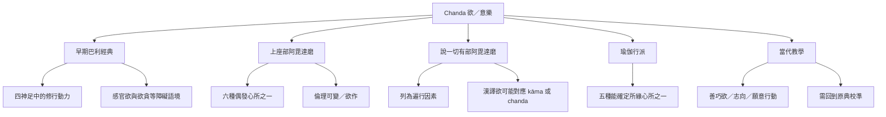

這張地圖比較的是不同論書傳統對心理因素的理論位置，以及現代教學如何重新表述 chanda。它不主張各系統彼此完全等同；相反地，分類差異本身就是研究對象。

## 參考

* [[上座部阿毘達磨把 Chanda 分析為倫理可變的欲作心所]]
* [[說一切有部與上座部對欲心所的分類位置並不相同]]
* [[瑜伽行派把 Chanda 放在五種能確定所緣的心所之中]]
* [[漢譯「欲」不能直接反推出唯一原語]]
* [[教學上的善巧對比不等於詞典式的絕對定義]]

回到主題導讀：[[Chanda_(Buddhism)]]。
