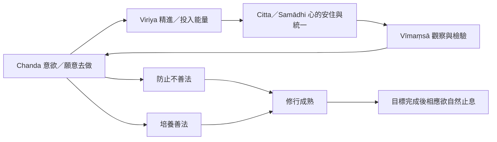

這張地圖呈現欲在實踐中的功能鏈：意欲定向行動，精進投入能量，心與定使活動穩定，觀察則持續檢驗並修正方法。四者不是僵硬的線性階段，而是互相支援的實踐條件。

## 參考

* [[data/SN 51.13 說明欲能成為定與正精進的基礎]]
* [[data/SN 51.15 以到達目的地的譬喻化解以欲斷欲的矛盾]]
* [[欲提供方向而精進提供持續投入的能量]]
* [[修行意欲可以在完成其功能後自然止息]]
* [[Iddhipāda]]、[[Viriya]]、[[Samādhi]]、[[Vīmaṃsā]]。

回到主題導讀：[[Chanda_(Buddhism)]]。
