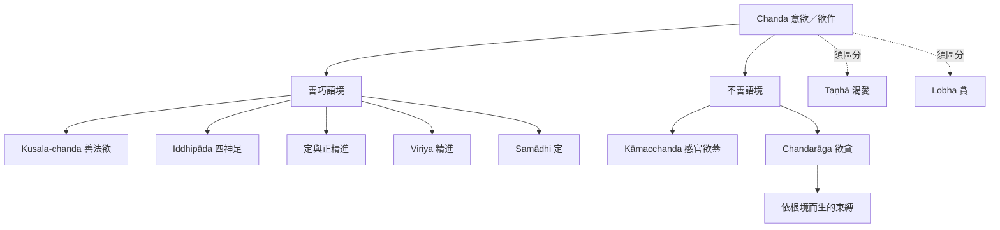

本地圖將 *chanda* 放回不同語境辨識：它可作為修行動力，也可出現在感官欲與欲貪的複合詞中。閱讀時應同時考慮原語、所緣、心理條件、倫理品質與修道功能。

## 參考

* [[早期經典把欲同時呈現為感官障礙與修行動力]]
* [[欲的倫理性質要由相應心理條件判斷]]
* [[修行的關鍵不是摧毀意欲而是鬆開貪染]]
* [[Chanda]]、[[Taṇhā]]、[[Lobha]]、[[Kāmacchanda]]、[[Chandarāga]]、[[Kusala-chanda]]、[[Iddhipāda]]。

回到主題導讀：[[Chanda_(Buddhism)]]。
