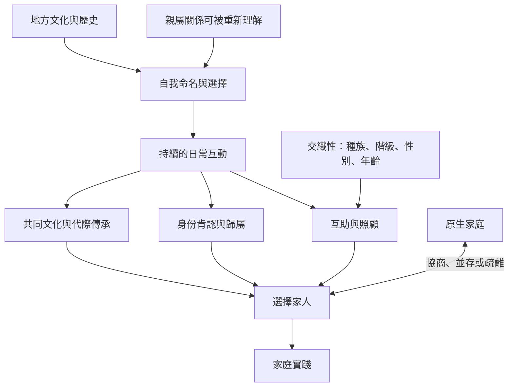

選擇家人由個人與群體在生活中逐步形成：親屬關係的界線可以改變，友誼與社群關係也能透過照顧、互惠、文化實踐和持續承諾，獲得家庭意義。形成過程並非所有地方都相同，應從當事人的命名與地方歷史出發。

## 延伸連結
* [[選擇家人是透過持續照顧實踐建立的親屬關係]]
* [[家庭不是只有血緣與法律也由關係承諾與互惠維繫]]
* [[選擇家人補足原生家庭但不應被浪漫化成替代品]]
* [[酷兒親屬關係會在族群文化地方與世代脈絡中呈現差異]]
* [[出櫃可能重組原生家庭而非必然造成斷裂]]
* [[舞廳之家把照顧教育表演與身份傳承組成社群基礎設施]]

## 概念
[[選擇家人]]｜[[家庭選擇]]｜[[親屬關係]]｜[[酷兒親屬關係]]｜[[原生家庭]]｜[[家庭實踐]]｜[[互助]]
