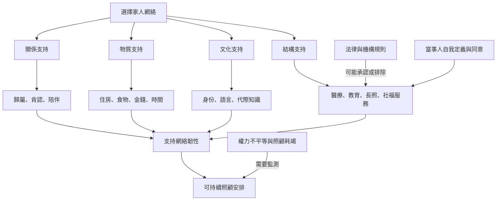

選擇家人能提供關係性、物質性與文化支持，但當生活進入疾病、長照或危機階段，親密關係本身未必足以維持照顧。支持網絡需要有可動員資源、替代人選、清楚界線與專業服務；制度則需要尊重當事人自我定義的家人，並釐清資訊分享、同意和法律權限。

## 延伸連結
* [[家庭支持同時包含情感物質文化與制度資源]]
* [[選擇家人的照顧勞動需要正式制度承認]]
* [[選擇家庭內部也有權力不平等與照顧負擔]]
* [[社會支持網絡的韌性取決於關係品質與可動員資源]]
* [[互助不等於即時等價交換而是承認資源與需求會隨生命階段改變]]

## 概念
[[社會支持]]｜[[照顧網絡]]｜[[互助]]｜[[社會資本]]｜[[長期照顧]]｜[[交織性]]
