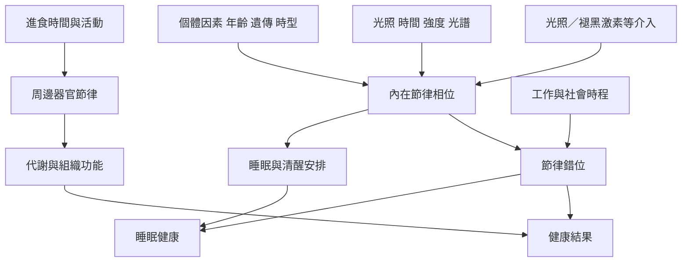

人體的節律健康由光照、睡眠、進食、活動、年齡與個體時型共同影響。這張地圖將基礎生理、可調整的生活因素與介入風險放在同一脈絡，避免把複雜健康議題簡化成單一作息技巧。

## 思與行
* 以 [[睡眠健康需要同時考量時長時相與規律性]] 釐清評估面向，再讀 [[節律介入必須重視時機個別差異與證據等級]]。
* 以 [[建立個人節律日誌而不是追求完美作息表]] 作為觀察練習，而非診斷工具。

## 參考
* 概念條目：[[Chronotype]]、[[Melatonin]]、[[Dim_light_melatonin_onset]]、[[Phase_response_curve]]、[[Circadian_misalignment]]、[[Chronotherapy]]。
* 相關筆記：[[光照的時機與強度共同塑造人體節律]]、[[進食與活動可以提供周邊時鐘的時間線索]]、[[時型是連續差異而不是早起者與夜貓子的道德分類]]。
