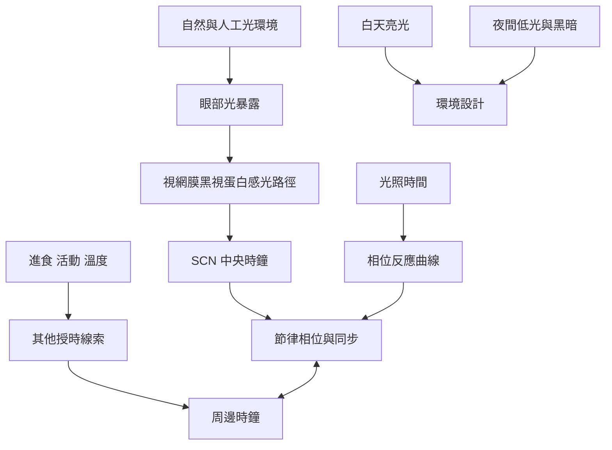

光照既是視覺資訊，也是人體生理時間的重要環境訊號。此地圖由光暗環境連結到感光路徑、中央時鐘、相位反應與日常環境設計。

## 思與行
* 參照 [[明亮日間光線與夜間低光環境是健康成人的共識型建議]]，把照明的時間性納入居住與工作空間設計。
* 以 [[以自然日照作為低科技校時工具]] 和 [[夜間城市應讓照明服務安全而不過度侵入生理夜晚]] 延伸為個人與社區行動。

## 參考
* 概念條目：[[Zeitgeber]]、[[Entrainment]]、[[Suprachiasmatic_nucleus]]、[[Phase_response_curve]]、[[Photoperiod]]。
* 相關筆記：[[外在授時因子讓內在時鐘與地球日夜保持同步]]、[[光照的時機與強度共同塑造人體節律]]。
