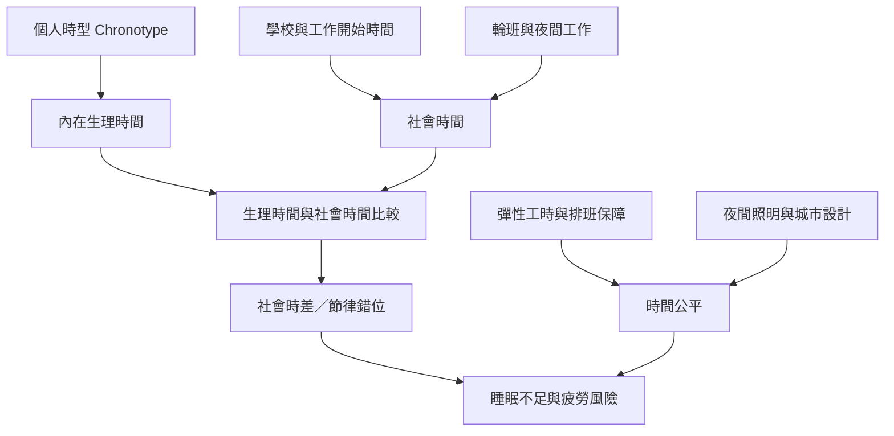

生理時鐘不是只存在於個人身體內，也嵌入工作制度、學校時間、照護安排、城市照明與夜間經濟。這張地圖呈現個體時型與社會時間如何互相作用，以及節律健康為何涉及勞動權與公共政策。

## 思與行
* 從 [[社會時差是制度性時間衝突而不只是個人自律問題]] 開始，連結 [[輪班者的節律健康需要工作場所共同承擔]] 與 [[節律健康是一種需要被公共制度支持的時間公平]]。
* 設計制度方案時，將夜間工作者、照護者、學生與支援職務納入決策，而非只考慮白領日班工作者。

## 參考
* 概念條目：[[Chronotype]]、[[Social_jetlag]]、[[Circadian_misalignment]]、[[Shift_work_disorder]]。
* 相關筆記：[[人類睡眠節律會隨生態與社會環境調整]]、[[時型是連續差異而不是早起者與夜貓子的道德分類]]。
