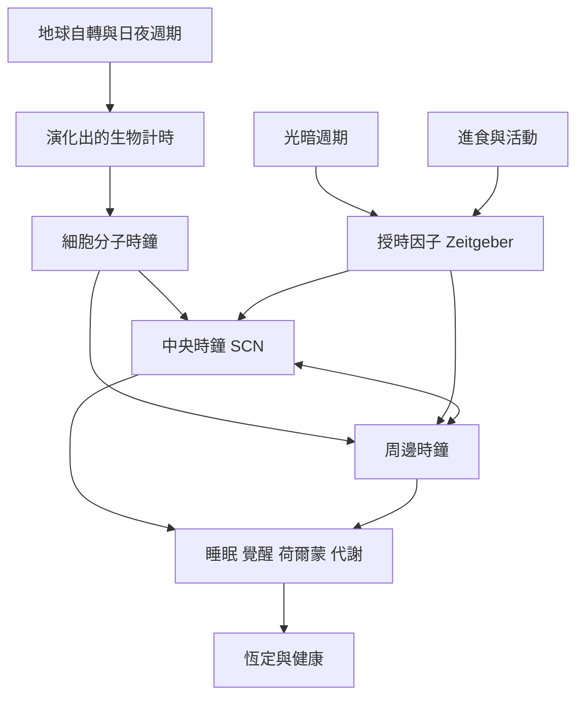

晝夜節律是由細胞分子振盪器產生、經由外在授時因子同步，並在多層級生物系統中表現的週期性時間組織。這張地圖從演化、分子機制到環境同步串起主要概念。

## 思與行
* 依序閱讀 [[晝夜節律是內生振盪而非固定的二十四小時作息規則]]、[[細胞分子時鐘透過基因回饋環路產生近二十四小時振盪]] 與 [[中央時鐘與周邊時鐘透過神經內分泌及組織訊號協調]]。
* 以 [[光照的時機與強度共同塑造人體節律]] 和 [[進食與活動可以提供周邊時鐘的時間線索]] 比較不同授時因子的角色。

## 參考
* 概念條目：[[Circadian_rhythm]]、[[Chronobiology]]、[[Biological_clock]]、[[Entrainment]]、[[Zeitgeber]]、[[Suprachiasmatic_nucleus]]、[[Peripheral_clock]]、[[Photoperiod]]。
* 相關筆記：[[生理時間是一種預測環境變化的內在秩序]]、[[外在授時因子讓內在時鐘與地球日夜保持同步]]、[[人體並非只有一個時鐘而是中央與周邊時鐘網絡]]。
